# 从线虫到果蝇幼虫再到果蝇成体再到人类，其大脑中神经元，化学突触，电突触，每神经元突触等等呈现快速递增趋势，其对应的个体智能程度呈现指数级增加。现在有线虫大脑工程化实现项目cadence，也有果蝇大脑工程化实现项目/Users/sheng/bionic_brain ，现在的核心问题是，是否存在一种generalized的类脑结构，在极其简单问题时，调用线虫大脑级别的神经元数，化学突触和电突触数以及每神经元突触数来构建架构回路解决简单问题。当遇到中等负责问题时，能够自适应提升参与的神经元，化学突触，电突触，每神经元突触等数量级，使参与处理中等复杂问题的神经元，化学突触，电突触，每神经元突触等数量级别达到果蝇，甚至更复杂大脑的级别。遇到更加复杂的问题依次类推。核心难点：1. 何时决定需要增加神经元，化学突触，电突触，每神经元突触等数量，需要增加多少，也就是如何解决generalized的类脑结构的scaling问题；2.对于当前问题，已有神经元，化学突触，电突触，每神经元突触等需要如何构建架构回路来解决当前问题，如何评价构建的架构回路解决问题的效果；3. 所有的持续学习以及需要额外神经元，化学突触，电突触，每神经元突触等数量增加的增强学习都是自主决策，自适应发生的。长期学习总结下来的固定经验（比如开车技能，游泳技能等等）需要如何沉淀下来称为固定神经回路结构模型。

# 从线虫到人类：构建能够自主扩容、持续学习和固化技能的 Generalized Brain Architecture

你的核心问题是可以研究、也值得工程化实现的。 我认为，真正有价值的方向不是简单地把线虫 connectome、果蝇 connectome 和人类神经网络依次放大，而是建立一种能够自主决定何时调用更多计算单元、何时创建新神经回路、何时增加连接，以及何时把学习结果固化为稳定技能的通用类脑架构。

我建议暂时将这一研究方向称为：

GBA：Generalized Brain Architecture（通用可生长类脑架构）

这里的 GBA 是本文提出的工作名称，并非声称已有一个公认的同名标准系统。

它应具备五种相互配合的能力：

1. 自适应规模（Adaptive Scaling）：简单问题使用很少的神经元和连接，复杂问题按需扩容。

2. 自适应布线（Adaptive Wiring）：根据任务目标和实际失败原因，自主形成适合问题的神经回路。

3. 自主持续学习（Autonomous Continual Learning）：从感知、行动、结果和预测误差中学习，而非始终依赖外部标注。

4. 技能固化（Skill Consolidation）：把反复验证成功的经验变成稳定、低成本、可复用的回路。

5. 资源与安全治理（Resource and Safety Governance）：让系统知道何时继续学习、何时停止扩容，以及何时应当回滚到已验证的回路。

其中最关键的认识是：

> 系统应该按需增加的是解决问题所需的有效计算能力，而不是机械地增加神经元数量。 神经元数量、突触数量、网络拓扑、动态状态、学习规则和模块协作方式，必须共同优化。

## 一、先明确生物大脑给我们的尺度参照


1. 线虫：完整小规模回路的研究起点

## 约 302 个神经元

雌雄同体线虫的经典神经系统数据

线虫具有经过长期研究的连接组（connectome），包含化学突触和电突触。一个重要特点是，我们不仅能研究网络规模，还能研究具体神经元、连接关系及行为之间的对应关系。


Open Connectome Project

+1


2. 果蝇幼虫：更复杂的多感觉与学习回路

## 3,016 个神经元

约 54.8 万个突触位点

2023 年发表的幼虫脑连接组研究揭示了高度递归的网络、多感觉整合、学习相关回路以及丰富的反馈结构。它说明，复杂程度的提升不仅体现在神经元数量上，也体现在连接拓扑和回路组织方式上。


PubMed

+1


3. 果蝇成体：大规模全脑连接组

## 139,255 个神经元

约 5,450 万个突触

2024 年的 FlyWire 全脑连接组工作为研究更大规模的神经网络提供了重要基础，也提供了大量可查询和分析的神经元及连接数据。


Nature

+1


4. 人类：超大规模、多层次神经系统

## 约 860 亿个神经元

突触数量常估计在约 10¹⁴ 量级

人类大脑的规模远超目前完整重建的线虫和果蝇连接组，但我们尚未掌握人类全脑每个神经元的完整连接与动态活动，更没有一个通过简单放大果蝇网络就能得到人类智能的通用公式。


Oxford Academic

这些数据适合用来建立从小规模到大规模的实验阶梯，但有三个必须纠正的认识。

第一，智能程度不能简单认为与神经元数量呈指数关系。 线虫、果蝇和人类的感知器官、身体形态、生态任务、发育机制和学习方式都不同；目前也没有跨物种统一、可直接比较的“智能指数”，可以证明神经元数量每增长一个数量级，智能就指数级提升。

第二，不能把所有数据中的“突触”直接相除后作严格比较。 文献中的突触位点、神经元之间的连接、单向连接、双向电耦合和神经肌肉连接，可能采用不同的计数规则。线虫数据中也存在按连接对数或突触位点统计而产生的差异。


Nature Communications

+1

第三，结构并不等于功能。 即便拥有完整 connectome，也还需要神经元的动态模型、连接强度、递质作用、输入编码、身体与环境模型，以及可验证的任务执行机制。大脑结构重建是重要基础，但它不是完整智能的充分条件。


Nature

+1

这正是 GBA 应该解决的问题：如何把规模、结构、学习和任务效果统一成一个能够自我调节的闭环。

## 二、Cadence、FlyBrain、FlyDrones 已经解决了什么，还缺什么？

这些项目值得作为 GBA 的研究基础，但需要区分：它们是在使用生物连接组构建仿真、验证某类行为，还是已经实现了能够自主扩容的通用智能架构。


### Cadence

持续学习、局部状态更新、递归反馈

它的线虫示例以 302 个神经元的连接组作为布线基础，其他示例则探索经验学习、世界模型和闭环动作。官方资料也明确表示，更广泛的世界预测、精确局部修复、长期能力保留及成本优势仍是需要进一步验证的研究目标。


GitHub

+1

项目：Cadence 官方介绍  · Cadence 示例代码 

对 GBA 的价值： 可以借鉴局部更新、循环反馈和持续学习机制，但不能据此认定它已经实现从线虫规模自主增长到果蝇乃至人类规模的完整机制。


### FlyBrain

果蝇连接组与神经动力学仿真

公开的 dylankainth/flybrain  项目尝试把果蝇神经网络用于无人机飞行控制。它的 README 报告了 139,255 个神经元和约 80 万个连接。原始 FlyWire 全脑重建则报告约 5,450 万个突触位点，因此必须进一步核实两者的过滤、聚合与计数口径，不能将运行中的约 80 万连接直接视为完整保留了原始全脑的全部突触。


GitHub

+1

对 GBA 的价值： 验证大规模网络如何承载传感输入、循环活动与运动输出，并研究神经动力学与硬件控制的接口。


### FlyDrones

神经网络、视觉输入、无人机控制

gradfly/flydrone  提供了简化网络和更大规模果蝇神经系统图的运行路径。其公开基准中，850 个神经元的 MiniFly 在特定双核云端环境下达到约 6–11 倍实时速度；一个经过筛选、约 166,700 个神经元和 2,558 万条有向连接的网络则约为 0.62 倍实时速度。这些数字依赖具体硬件、时间步和网络筛选方式，并不是通用性能结论。


gradfly/flydrone: 果蝇大脑无人机 · GitHub

+1

对 GBA 的价值： 让架构接受真实的闭环任务考验，评价端到端控制效果、延迟、稳定性和资源成本，而不仅仅是神经网络能否运行。

### 当前真正缺失的是什么？

截至 2026 年 10 月，在上述公开项目和相关技术路线中，我没有找到一套已经充分验证、同时具备以下全部能力的成熟系统：

* 可以自主判断现有回路是否足够，而不是事先指定网络大小。

* 可以自主决定增加多少神经元、化学突触、电突触及其连接密度。

* 可以按任务需要构建、测试、修正和淘汰神经回路。

* 可以在扩容和持续学习时避免旧技能遗忘、计算资源失控和网络结构退化。

* 可以将长期成功经验沉淀为可复用的固定技能回路。

不过，这些目标并非完全没有理论和工程基础。例如，动态可扩展网络 DEN 研究了持续学习中按需扩充网络容量，条件计算和混合专家架构研究了按输入激活部分网络，分层强化学习研究了可组合、可复用的技能。


arXiv

+2

GBA 的研究重点应该是把这些分散的能力整合成一套统一、自主、可验证的结构生长机制。

## 三、GBA 的核心设计：先扩大参与程度，再决定是否扩大结构

这是我认为整个方案最关键的架构原则。

简单问题不需要创建新神经元。已有的回路可能完全足够，只需要调用更少的神经元、激活更少的连接、进行更少的递归计算。

中等复杂度的问题可能只需要激活现有网络中的更多模块，或增强少量连接。

只有当已有容量确实无法满足任务要求时，才应该进行结构扩容。

因此，GBA 必须区分两个经常被混淆的变量：

* 现有总容量：系统目前拥有多少神经元单元、连接和回路模块。

* 当前活动容量：当前任务实际调用了多少神经元单元、连接和模块。

例如，一套系统可能总共拥有 3,000 个神经元等效单元，但处理简单任务时仅需要激活其中 80 个。完成复杂任务时，可以激活 1,200 个，而不必为了每次复杂输入重新创建神经元。

只有当 3,000 个单元的可用容量本身也不足时，才进入真正的结构生长阶段。

### 3.1 把神经系统表示为一个可生长的动态图

可以用以下状态描述 GBA 在时刻 ttt 的结构：

Gt=(Vt,Etc,Ete,Wt,Xt,Mt)\mathcal{G}_t=(V_t,E_t^{c},E_t^{e},W_t,X_t,M_t)Gt=(Vt,Etc,Ete,Wt,Xt,Mt)

其中：

|
符号

|

含义

|
| --- | --- |
|

VtV_tVt

|

神经元等效计算单元集合

|
|

EtcE_t^cEtc

|

有向的化学突触式连接集合

|
|

EteE_t^eEte

|

双向的电突触式耦合集合

|
|

WtW_tWt

|

连接强度、延迟、兴奋性及相关参数

|
|

XtX_tXt

|

神经元的动态内部状态

|
|

MtM_tMt

|

功能模块、记忆和技能回路的组织结构

|

这里的电突触式连接是计算架构中的一种抽象，不意味着任意双向连接都具有生物电突触的全部生理机制。

尤其需要注意：不能只记录网络的平均连接数。每个节点还应记录输入连接数、输出连接数、连接权重分布、模块归属和动态活动水平，因为不同神经元承担的功能可能完全不同。

### 3.2 四种扩容操作应分开控制

操作 A：动态激活（Activation Scaling）

不改变网络结构，只激活更多现有神经元或回路。适用于已有模块能够解决问题，但当前参与计算的资源不足的情况。

操作 B：连接可塑性（Synaptic Scaling）

调整现有化学突触和电突触式连接的强度、延迟、阈值或局部学习参数，不一定增加节点或连接数量。

操作 C：结构布线（Structural Wiring）

按需添加或删除连接，调整局部连接密度和回路拓扑。它解决的是信息传递路径不合理、协同不足或缺乏必要反馈的问题。

操作 D：神经元及模块生长（Neurogenesis / Module Growth）

创建新的神经元单元、局部回路，必要时形成完整的新功能模块。只有当前三类调整不能以合理成本达到任务要求时，才应优先考虑这种更昂贵的扩容方式。

这四类操作是递进的候选策略，而不是绝对僵硬的固定顺序。例如，遇到新的感知模态时，系统可能确实需要直接创建新的输入模块。不过，对大多数任务，先测试低成本方案，更容易避免不必要的结构膨胀。

## 四、核心难点一：何时扩容，扩多少？

这实际上是一个在线容量分配与结构生长决策问题。

不能仅仅根据问题被分类为“简单、中等、困难”决定网络大小。因为同一个任务，对已经学会开车的系统和从未接触过车辆的系统而言，需求可能完全不同。

例如，驾驶任务可能本身相当复杂，但如果系统已经拥有经过验证的驾驶技能回路，日常驾驶就不应该持续触发扩容。

### 4.1 建立扩容监测器，而不是依靠单一复杂度评分

GBA 应持续监测六组信号：

|
监测信号

|

需要回答的问题

|

潜在行为

|
| --- | --- | --- |
|

任务表现误差

|

任务是否经常失败？

|

考虑学习或扩容

|
|

预测误差

|

真实结果是否持续偏离模型预测？

|

修复世界模型或局部回路

|
|

不确定性

|

系统是否不知道当前情形如何处理？

|

增加信息采集或探索

|
|

资源饱和

|

当前被调用的节点及连接是否接近预算上限？

|

考虑扩大活动容量

|
|

学习停滞

|

继续调整已有参数是否仍有明显收益？

|

考虑结构生长

|
|

旧技能受损

|

新学习是否造成已有能力退化？

|

保护或修复旧回路

|

这些信号不能孤立使用。

例如，预测误差上升不一定意味着神经元不足，也可能意味着传感器故障、环境突变、任务目标变化或者现有模型根本不适用。此时直接扩容不仅可能无效，还会使系统变得更复杂。

### 4.2 用统一的扩容评分表达决策

可以先构造一个工程上可检验的决策模型：

Gt=wEEt+wUUt+wNNt+wSSt+wIIt−wCCt\begin{aligned} G_t={}&w_E E_t+w_U U_t+w_N N_t\\ &+w_S S_t+w_I I_t-w_C C_t \end{aligned}Gt=wEEt+wUUt+wNNt+wSSt+wIIt−wCCt

其中：

* EtE_tEt：归一化任务误差和预测误差。

* UtU_tUt：模型不确定性。

* NtN_tNt：环境或任务的新颖性。

* StS_tSt：活动神经元、连接或模块的饱和程度。

* ItI_tIt：学习干扰、旧技能退化或模块冲突指标。

* CtC_tCt：扩容的计算、内存、延迟及能耗成本。

* wE,wU,wN,wS,wI,wCw_E,w_U,w_N,w_S,w_I,w_CwE,wU,wN,wS,wI,wC：需要通过实验校准的权重。

以上公式是建议的初始工程模型，不是已有的生物学定律。

真正重要的是采用多条件门控，而不是让 GtG_tGt 过一个固定阈值就无限扩容。例如：

1. 任务表现持续未达到要求。

2. 系统已有模块呈现容量饱和，或者继续学习的收益已明显停滞。

3. 经诊断确认，失败确实与模型容量或回路结构有关。

4. 预测扩容带来的改善足以抵偿额外成本。

5. 不违反既定的安全和资源预算。

对于突发危险，不应等待连续多次失败后才采取保护动作；安全响应和结构扩容应该是两套不同的机制。

### 4.3 扩多少：寻找满足目标的最小容量

不要预先规定“简单任务 302 个神经元，中等任务 3,016 个，复杂任务 139,255 个”。

这些数字可作为不同规模实验的参照，却不能直接作为任务难度到神经元数量的映射。

更合理的目标是：

min⁡G′Cost⁡(G′)s.t.E\(L(G′)\)≤ε,Retention⁡(G′)≥rmin⁡,Risk⁡(G′)≤qmax⁡.\begin{aligned} \min_{\mathcal{G}'}\quad& \operatorname{Cost}(\mathcal{G}')\\ \text{s.t.}\quad& \mathbb{E}\(\\mathcal{L}(\\mathcal{G}')\) \leq \varepsilon,\\ &\operatorname{Retention}(\mathcal{G}') \geq r_{\min},\\ &\operatorname{Risk}(\mathcal{G}') \leq q_{\max}. \end{aligned}G′mins.t.Cost(G′)E\(L(G′)\)≤ε,Retention(G′)≥rmin,Risk(G′)≤qmax.

这里的目标是找到满足任务误差、旧技能保留和安全要求的最小成本网络。成本可以综合计算活动神经元数、连接数、计算延迟、能耗和存储需求。

由于未来任务和环境无法完全预知，实际工程中不可能每一步都求得严格的全局最优解。可以改用小规模试生长、离线评估和逐步扩容。

我的建议是采用渐进式扩容 + 边际收益验证：

边际收益率=Δ任务效能Δ计算与结构成本\text{边际收益率} = \frac{\Delta\text{任务效能}} {\Delta\text{计算与结构成本}}边际收益率=Δ计算与结构成本Δ任务效能

当新增模块的收益率不足、表现没有稳定改善，或者成本与风险过高时，就停止增长，必要时回滚。

这样可以避免两个极端：一是容量不足导致无法学习新技能，二是面对每次困难都无限增加神经元，最终形成庞大却低效的网络。

## 五、核心难点二：如何让当前的神经元形成正确的神经回路？

这是 GBA 中另一个独立的问题。

即使系统拥有足够多的神经元，也不意味着它们会自动组成有效的回路。容量解决的是“有多少计算资源”，布线解决的是“这些资源如何协同”。

我建议采用“任务目标驱动、预测误差定位、局部生长、闭环验证”的机制。

### 5.1 建立最小功能核心

无论是控制机械臂、驾驶汽车，还是解决简单逻辑问题，GBA 都可以使用统一的核心接口：

* 感知模块：把视觉、听觉、触觉、传感器等输入编码成内部状态。

* 状态与世界模型模块：预测环境如何变化，以及动作会产生什么后果。

* 记忆与技能模块：检索已掌握的规律及程序性技能。

* 决策与动作模块：根据当前目标产生行为。

* 价值与学习模块：评估预测误差、奖励、风险和行为结果。

* 结构调节模块：决定是否调整连接、激活新模块或生成新的神经元群组。

这是功能分解，不意味着生物大脑恰好存在这六个独立的实体结构。实际实现可以让这些功能使用重叠的递归回路。

### 5.2 对失败进行局部归因

假设 GBA 学习驾驶。

第一次遇到普通直路时，系统可能只需要一个小型感知—转向—速度控制回路。

遇到连续弯道时，系统可能通过激活更多已有状态记忆、路径预测和转向协调单元来解决问题。

当它遇到雨天湿滑路面时，问题可能不是简单地缺少神经元，而是原有世界模型没有充分描述路面摩擦。它可能只需调整预测回路和连接权重。

当系统需要在湿滑路面上同时处理视觉遮挡、横向控制、紧急制动及其他车辆的行为时，如果已有回路之间缺乏足够的信息交流，就可能需要添加新连接或新的专用模块。

这意味着扩容前必须先回答：

当前的失败究竟来自节点不足、连接不足、状态表示不够、学习规则不适合，还是已有模块之间缺乏协调？

### 5.3 分别管理化学突触式连接与电突触式连接

这里不应把两类连接混为一个统一的“边数量”。

|
计算架构中的连接

|

主要用途

|

适合处理的问题

|
| --- | --- | --- |
|

化学突触式有向连接

|

传递有方向性的信号，执行变换、抑制或调节

|

信息流动、状态转换、预测、记忆关联

|
|

电突触式双向耦合

|

快速的双向状态耦合与同步

|

局部协调、状态同步、低延迟信息整合

|

在 GBA 中，有向化学突触式连接可拥有独立权重、延迟和局部学习规则；电突触式连接应以双向耦合机制实现，并对其同步效果、稳定性及作用范围进行约束。

如果某一模块已能正确提取信息，但传递路径缺失，系统可以优先增添有向连接。如果多个节点各自掌握正确状态，却无法及时协调，双向耦合可能是值得测试的候选方案。

不过，这些是计算层面的功能类比，并非声称人工网络已经完整复现了生物突触的生理机制。

### 5.4 用增量布线而不是随机生成整张网络

每次生长时，建议保存以下信息：

1. 失败发生在哪些任务、时间和环境条件下。

2. 哪些神经元活动与预测误差或动作失误相关。

3. 新连接或新模块试图解决什么特定瓶颈。

4. 修改前后的任务表现、延迟和资源成本。

5. 修改是否破坏其他已掌握技能。

如果一个新增回路只在训练过的场景中奏效，却没有改善未见场景的表现，或者严重影响原有技能，就不应直接认定为有效生长。

因此，一个完整的神经回路需要同时包含结构假设、可学习参数、适用条件、验证结果和回滚机制。

## 六、核心难点三：如何自主决定持续学习，以及将经验固化为固定神经回路？

这里要区分两个过程：学习中的在线变化，以及把知识转化为长期稳定能力的巩固过程。

生物大脑的记忆巩固与经验重放之间存在重要联系；计算系统中的持续学习也已有动态扩容、技能库、知识重放等相关研究。


ScienceDirect

+2

我建议 GBA 把整个生命周期划分为四种工作状态。

状态 A：熟练执行

当前输入与已掌握技能匹配，模型置信度充分，行为在安全范围内。系统调用成熟回路完成任务，尽量不触发结构修改。

状态 B：在线微调

观察到轻微预测偏差或结果退化时，优先更新少量连接权重、阈值、短期状态和相关局部参数。

状态 C：结构学习

遇到持续失败、新任务类型或明确的容量瓶颈时，尝试添加连接、创建专用回路或扩展模块，并在隔离测试中验证。

状态 D：记忆巩固

将反复得到验证的回路、权重、触发条件和动作序列固化到技能库中，减少后续执行成本，同时检查它们能否与既有技能组合。

这些工作状态不必严格按顺序发生：系统可以在执行一个熟练技能的同时，对另一个模块进行学习，之后再统一审核和巩固。

### 6.1 自主学习信号从哪里来？

GBA 不应只依赖外部奖励。它可以融合四种反馈：

* 预测误差：实际发生的事情是否与模型预期一致。

* 任务结果：动作是否完成目标，结果是否满足约束。

* 新颖性与不确定性：当前状况是否超出已有回路的可靠适用范围。

* 经验回报：某种行为在长期来看是否优于替代行为。

在可直接获得奖励的任务中，强化学习可以用来评估策略改进；在没有现成奖励标签的环境中，系统也可以先通过预测误差更新世界模型，并在获得可靠的目标或行为结果后修正策略。

这里必须防止一种常见失败：预测误差大不等于应该学习，奖励高也不等于所有变化都值得长期保留。 需要结合数据可靠性、任务目标和安全约束决定。

### 6.2 怎样把开车、游泳等技能变成固定神经回路？

这部分可以借鉴分层强化学习中的技能或 option 表示。一个可复用技能不只是一个权重矩阵，而应包含策略、适用状态和终止条件等信息。


Proceedings of Machine Learning Research

+1

我建议每个固化技能至少由以下六个部分构成：

|
组成部分

|

作用

|
| --- | --- |
|

技能回路拓扑

|

记录核心神经元模块及其连接方式

|
|

学习后的参数

|

保存连接权重、状态转移规律和时间动态

|
|

启动条件

|

判断什么情况下应调用这一技能

|
|

执行策略

|

说明在不同状态下如何采取行动

|
|

终止及异常条件

|

判断何时结束、失败或交由其他技能接管

|
|

验证与版本记录

|

保存测试证据、适用范围、限制和修订历史

|

以驾驶为例，不应该将“驾驶”固化成一个不可拆解、不能更新的巨大网络，而应形成车道保持、转向、制动、障碍物规避和路径跟踪等可以独立验证、按需组合的技能回路。

长期学习之后，系统就可以在常规情况下直接组合成熟技能，只对陌生情境调用更昂贵的预测和学习过程。

### 6.3 固化不等于彻底冻结

我建议采用三层记忆管理：

快速可塑层。 负责短期状态、近期经验和小范围参数更新。它可以灵活变化，但应受到约束。

长期稳定层。 保存经验证的核心技能回路与重要连接，使用参数保护、历史经验重放和回归测试，减少新任务对旧知识的破坏。

技能组合层。 负责选择已有技能、调整技能调用顺序，并在必要时组合多个模块解决新任务。

如果一个技能在多个环境和扰动条件下稳定成功，就可以提高其固化等级；如果环境变化导致效果退化，系统应重新评估该技能的适用范围，而不是盲目修改整个长期记忆。

这将使“固定神经回路结构模型”具备工程上可操作的定义：核心结构稳定，调用条件明确，常规执行成本低，必要时允许受控修订，并且每一次关键修订都可以回溯。

## 七、把上述机制统一起来：GBA 的闭环架构

下面是我建议的第一版整体数据流。



这套架构有一个核心特征：扩容不是一个独立的预设阶段，而是嵌入持续运行过程中的一种受控行动。

它可以在简单任务上长时间保持较小活动规模，也可以在复杂任务上临时调用大量已有单元；如果系统真的遇到新能力缺口，才会创建并验证新的结构。

不过，必须强调，这张图是拟议的系统设计，不是对目前某个现成项目功能的描述。它还需要通过实验确定诊断指标、增长规则、回路表示、学习稳定性及其安全边界。

## 八、怎样证明 GBA 真的有效，而不是只让网络越来越大？

这是项目能否成为严肃研究工作的决定性环节。

至少应建立六组可量化指标。

|
评估类别

|

必须回答的问题

|

建议指标

|
| --- | --- | --- |
|

任务能力

|

任务是否完成得更好？

|

成功率、奖励、误差、完成时间

|
|

资源效率

|

改善付出了多少成本？

|

活动节点数、连接数、延迟、能耗

|
|

扩容质量

|

新增结构是否真正有用？

|

每单位新增成本带来的性能改善

|
|

泛化能力

|

没见过的场景能否处理？

|

未见任务和环境的测试表现

|
|

持续学习

|

学新技能会不会忘记旧技能？

|

旧任务保留率、遗忘量、迁移收益

|
|

稳定和安全

|

修改会不会造成不可接受的行为？

|

失稳率、回滚率、约束违规率

|

尤其要做三个对照实验。

首先，比较固定规模网络与自适应网络，确认自适应扩容是否确实改善了任务性能，而不只是增加了参数。

其次，在相同资源预算下比较随机增加节点、只调整权重、只增加连接，以及联合结构生长的方法，判断什么机制真正有贡献。

最后，进行回路消融与恢复测试：移除一个已经固化的技能模块，观察特定能力是否退化；恢复或替换它之后，观察能力是否重新出现。这能够验证结构与功能之间是否存在稳定的因果关联，而不仅仅是两者共同出现。

## 九、推荐的实际实施路线：由线虫规模开始，逐步验证自主生长

不建议一开始就构建百万神经元规模的通用网络。更高效的方式是先验证规模调节机制本身，再逐步引入更复杂的连接组、任务和动力学。

1. 阶段 1：建立最小可运行核心

   使用数十至数百个神经元等效单元，或者以线虫连接组为结构先验，完成一个可测量、可反复运行的小任务。先验证输入、状态、回路、动作和反馈闭环。

2. 阶段 2：实现活动规模自适应

   暂时禁止创建新神经元，只允许动态激活和停用模块。测试系统是否能用更少的活动节点完成简单问题，并在困难问题上主动调用更多已有资源。

3. 阶段 3：实现自主结构可塑性

   加入局部增删连接、节点复制或生成、稀疏布线和回滚机制。使用可控的合成任务验证增长信号能否识别真实的容量瓶颈。

4. 阶段 4：引入技能固化和持续学习

   连续训练多个任务，记录新增神经元、突触、回路成本和新旧任务表现。重点检测扩容是否改善新技能，以及旧技能是否仍能可靠执行。

5. 阶段 5：接入果蝇规模的结构先验

   使用幼虫或成体果蝇的公开连接组，验证同一套调节器能否适用于更复杂的递归网络、多感觉输入和运动任务。要区分原始连接组、经过筛选的连接子图和实际运行模型。

6. 阶段 6：挑战跨任务迁移与大规模控制

   最终在无人机、机械臂、驾驶仿真或需要世界模型的任务中评估自主扩容、实时性、鲁棒性和技能复用。不能仅靠网络规模与连接组相似度判断成功。

这条路线的关键不是证明一个 302 神经元的网络能够复制所有线虫行为，而是证明一个统一的调节机制可以从小规模开始，在出现真实需求时，通过有效学习逐步获得更大的任务处理能力。

## 十、我对这项研究最重要的建议

如果要把 GBA 发展成一项有明确研究贡献的工作，我建议把创新重点放在三个相互关联的核心问题上：

第一，学习与结构生长的统一决策理论。 要解释何时调整权重、何时增删连接、何时创建新神经元群组，并通过成本约束、性能指标和安全条件给出可验证的决策准则。

第二，神经回路的自组织与因果评价。 不仅要让网络在运行中产生连接，还要证明这些连接形成了有用的计算结构，并且能够通过消融、干预和跨环境测试验证其功能。

第三，从在线经验到长期程序性技能的巩固机制。 将临时可塑性、长期稳定回路、技能触发条件和组合策略纳入同一套记忆架构，让系统能够在持续学习时保护已有能力，并用成熟回路降低后续任务的计算成本。

最终，GBA 应追求的不是让一个网络永远增长，而是形成这样一种机制：

需要时生长，够用时停止；复杂问题调用更多能力，熟练技能以低成本执行；新经验能够改变系统，但不能轻易破坏已经验证的能力。

这比单纯地将线虫连接组放大到果蝇规模，或将整张果蝇连接组直接部署到无人机上，更接近你真正想实现的通用、自适应、可持续进化的类脑智能架构。


# 对于以上分析出来的各种问题，需要给出合理化的解决方案。其中Equilibrium Propagation能否适应网络scaling过程等等问题全部需要给出详细的方案，最终需要确保GBA能够工程化落地

# GBA 工程化实施方案：从 Equilibrium Propagation 到自主生长的类脑系统

## 一、首先给出核心结论

GBA 应该采用以自主容量管理为核心、以 Equilibrium Propagation（EP）为重要学习机制、以模块化神经回路和技能固化为基本组织形式的混合类脑架构。

这里有一个必须明确的设计决定：

不能把 Equilibrium Propagation 当作 GBA 的唯一学习算法，也不能假定 EP 会自动解决网络扩容问题。

EP 的研究已经从浅层能量模型发展到更深的卷积网络。2021 年的研究通过正负两侧的对称扰动，大幅降低了有限扰动造成的梯度估计偏差，并在 CIFAR-10 上报告了 11.7% 的测试错误率；2024 年发表的 Jacobian homeostasis 研究进一步探讨了非对称权重下的 EP，并在 32×32 ImageNet 等任务中验证了相应方法。


前沿出版

+1

这些结果说明 EP 具有扩展到复杂网络的研究基础，但它们并不等于已经证明 EP 可以直接驱动一张不断增加神经元、化学突触和电突触、不断改变拓扑的通用类脑网络。

要让 GBA 真正落地，必须把原本混在一起的问题拆开：

|
子系统

|

核心职责

|

推荐技术路线

|
| --- | --- | --- |
|

神经动力学系统

|

维护神经元状态、连接和回路活动

|

稀疏图计算、可插拔神经元动力学

|
|

局部学习系统

|

在固定或暂时稳定的回路内调整参数

|

EP、局部 Hebbian/STDP 学习

|
|

结构生长系统

|

决定增删节点、连接和模块

|

约束优化、候选结构搜索、增量生长

|
|

任务与控制系统

|

决定动作、预测环境和评估长期结果

|

世界模型、强化学习、分层技能策略

|
|

记忆与巩固系统

|

防止遗忘并固化经过验证的技能

|

受保护回路、经验重放、技能库

|
|

自主治理系统

|

协调资源、探索、安全、回滚和版本管理

|

预算控制、在线诊断、事务式结构更新

|

这不是简单堆叠六个独立模型，而是让六个子系统构成一个闭环。

整个 GBA 的工程目标是：

给定任务与资源预算，自主找到足够有效、成本可控且可持续学习的回路结构\boxed{ \text{给定任务与资源预算，} \quad \text{自主找到足够有效、成本可控且可持续学习的回路结构} }给定任务与资源预算，自主找到足够有效、成本可控且可持续学习的回路结构

工程验收不能只看成功率，还必须同时检验资源效率、结构可解释性、跨任务迁移、旧技能保留及持续运行的稳定性。

## 二、先解决最重要的理论问题：EP 到底适不适合网络 scaling？

### 2.1 EP 能做什么？

传统 Equilibrium Propagation 是一种基于能量函数的学习框架。网络在给定输入后先达到一个自由平衡状态，再通过目标信息施加小扰动，观察网络状态发生的变化，据此计算参数更新。

设：

* xxx：外部输入；

* yyy：目标输出或监督信号；

* sss：网络内部状态；

* θ\thetaθ：神经元、突触及回路的可学习参数；

* F(θ,s,x)F(\theta,s,x)F(θ,s,x)：网络的能量函数；

* C(s,y)C(s,y)C(s,y)：任务损失函数；

* β\betaβ：目标扰动强度。

自由相可写为：

s0≈Equilibrium⁡\(F(θ,s,x)\).s^0 \approx \operatorname{Equilibrium} \big\(F(\\theta,s,x)\\big\).s0≈Equilibrium\(F(θ,s,x)\).

加入目标扰动后：

sβ≈Equilibrium⁡\(F(θ,s,x)+βC(s,y)\).s^\beta \approx \operatorname{Equilibrium} \big\(F(\\theta,s,x)+\\beta C(s,y)\\big\).sβ≈Equilibrium\(F(θ,s,x)+βC(s,y)\).

在满足相关可微性、稳定平衡等假设的情况下，EP 使用两种状态下的局部参数梯度差，来估计任务目标的梯度：

∇θJ^=∇θF(θ,sβ,x)−∇θF(θ,s0,x)β.\widehat{\nabla_\theta J} = \frac{ \nabla_\theta F(\theta,s^\beta,x) - \nabla_\theta F(\theta,s^0,x) }{\beta}.∇θJ=β∇θF(θ,sβ,x)−∇θF(θ,s0,x).

当扰动趋近于零，并且相应平衡解及导数满足理论条件时，这个估计收敛到目标函数的真实梯度。


前沿出版

+1

对于一个能量函数满足条件的神经回路，这种方法的优势在于：学习信号可以通过网络自身的状态变化传播，局部突触根据其前后神经元状态进行更新，而不必为每个神经元单独构建传统反向传播的显式计算路径。

### 2.2 EP 不会自动决定增加多少神经元

原因很直接。

EP 主要解决的是：

> 已经具有一定结构的网络，怎样根据任务目标调整参数？

GBA 的 scaling 则需要回答：

> 当前结构是否足够？如果不足，应该在哪里新增节点、增加多少连接，以及怎样判断新结构是否值得保留？

这两个问题并不等价。

在固定拓扑的 EP 模型里，神经元数量和连接关系通常属于给定模型结构的一部分。即使 EP 将现有权重优化得很好，也不能单凭梯度更新就直接得出“此时应该增加 100 个神经元”的结论。

因此必须设置一个独立的结构生长控制器（Structural Growth Controller，SGC），由它判断当前回路是否达到容量瓶颈，并决定是否调用 EP 对新结构进行训练。

### 2.3 scaling 可以分成三个不同层次

层次 A：参数 scaling

神经元和连接数不变，调整已有突触权重、阈值及动力学参数。EP 最适合先在这一层接受验证。

层次 B：回路 scaling

增加、删除连接，修改局部回路拓扑，但暂不改变系统的功能模块数量。EP 可以参与固定新拓扑后的参数优化，但结构选择仍需要单独的决策机制。

层次 C：模块与神经元规模 scaling

创建新神经元群组、新的局部回路或全新的任务模块。结构控制器负责候选模块的生成、预算分配和验证；EP 只负责那些适合采用能量学习的部分。

这一分层会直接决定整个工程能否正常运行：如果系统一边执行 EP 的自由相和扰动相，一边无约束地增删节点，那么两次状态计算可能对应不同的网络结构，局部梯度差就不再具有原有推导所要求的明确含义。

工程规则：执行一组 EP 学习计算时，固定被优化子网的结构与关键动力学配置；任何结构修改都必须经过独立的生长事务。

这不是说网络拓扑永远不能改变，而是说结构改变和参数学习必须采用可管理、可验证的协调机制。

## 三、GBA 应采用怎样的总体架构？

我建议采用四个时间尺度、五类核心运行机制。

四个时间尺度分别是：神经元状态更新、参数学习、结构生长、长期技能巩固。它们不应该每次都同时运行。

例如，在正常驾驶时，神经元状态和动作控制可以持续快速更新；突触参数只在确实需要时改变；结构生长可以延迟到诊断出稳定的能力缺口后；技能固化则在新技能经过充分验证之后进行。

### 3.1 四个时间尺度

|
时间尺度

|

主要工作

|

是否允许修改网络拓扑

|
| --- | --- | --- |
|

快速运行层

|

感知、内部状态更新、预测和动作

|

不允许

|
|

中速学习层

|

EP、局部可塑性、策略更新

|

默认不允许

|
|

慢速结构层

|

创建神经元、增删连接、生成模块

|

允许，但须通过审核

|
|

长期巩固层

|

技能验证、版本固化、历史回放

|

只允许受控发布

|

这有助于避免一个关键工程问题：如果每一次短暂的预测误差都可以触发节点创建，GBA 的网络规模就容易随着运行时间增长，而不是随着实际能力需求增长。

### 3.2 五个相互配合的机制

.png>)

其中最重要的是，容量诊断器、结构生长控制器和 EP 学习器必须是不同的逻辑组件。

EP 学习器不能通过自身一次损失上升就决定扩容；结构生长控制器也不应该直接修改正在处理实时任务的网络。所有结构变更都必须有独立的候选版本和验证记录。

## 四、Equilibrium Propagation 的详细工程适配方案

### 4.1 不要从全脑级 EP 开始，要从 EP 兼容的最小模块开始

第一版 GBA 应实现一种连续值、稀疏连接、具有明确能量函数的神经回路。

设内部状态为 sss，其动力学为：

τdsdt=−∇sF(θ,s,x).\tau \frac{ds}{dt} = -\nabla_s F(\theta,s,x).τdtds=−∇sF(θ,s,x).

这里 τ\tauτ 表示状态更新的时间尺度。此模型通过能量下降趋向局部稳定状态。实际离散实现中，必须根据能量函数和动力学选择稳定的更新步长，并检测状态是否振荡或发散。

这一模型并不是所有神经元都必须采用的最终形态，而是为了先得到一个便于推导、能够验证梯度和收敛性的 EP 基准模块。

初始阶段至少实现三种参考算法：

1. 标准 EP：自由相与正向扰动相。

2. 对称扰动 EP：用正、负扰动的对称差分降低有限扰动偏差。

3. 反向传播参考实现：只在小规模确定性测试网络上使用，用来检查 EP 的梯度估计是否正确。

反向传播在这里是验证工具，不是要求最终系统必须全部采用反向传播。

随后，再根据实验结果决定是否引入 holomorphic EP 或 Jacobian homeostasis。前者有严格的复解析条件，不能直接照搬到任意非线性脉冲神经元；后者旨在改善非对称连接网络中的功能雅可比不匹配问题，但也不能自动保证任意神经动力学都满足 EP 的要求。


arXiv

+1

### 4.2 EP 兼容模块的标准接口

每个 EP 模块都应实现如下接口：

Python

运行

---
```
class EquilibriumModule:
    def initialize_state(self, inputs, seed=None):
        """Initialize the internal state."""
        raise NotImplementedError

    def settle_free(self, inputs, limits):
        """Find a stable free-phase state."""
        raise NotImplementedError

    def settle_nudged(self, inputs, target, beta, limits):
        """Find a stable target-perturbed state."""
        raise NotImplementedError

    def local_parameter_gradients(self, state, inputs):
        """Compute local energy derivatives."""
        raise NotImplementedError

    def propose_parameter_update(self, free_state, nudged_state, beta):
        """Return an update proposal without committing it."""
        raise NotImplementedError

    def check_convergence(self, state_history):
        """Return convergence and stability diagnostics."""
        raise NotImplementedError
```
---

这段代码是接口设计草案，不是一个已经完成的 EP 实现。具体的梯度、能量函数及参数更新必须根据所选的神经元动力学确定。

这里的 `propose_parameter_update` 只生成候选更新，不直接提交参数。提交行为由外部训练事务控制，从而保证 EP、结构生长和技能版本管理互不冲突。

### 4.3 必须实现的收敛控制

每次自由相或扰动相，都应该检测：

* 相邻迭代的状态变化是否低于规定阈值。

* 能量是否趋于稳定，是否出现持续振荡。

* 是否超过最大迭代次数。

* 是否出现数值溢出、NaN 或状态发散。

* 自由相和扰动相是否使用同一网络版本及一致的输入条件。

如果自由相未收敛，就不应把这次结果当作正常 EP 梯度更新。如果扰动相收敛失败，也不应继续应用本次更新。

在生产系统中，还应记录每次达到平衡所需的迭代次数。随着网络扩大，平衡时间可能增长，即便单次稀疏更新的成本仍然不高。

### 4.4 怎样处理 EP 的扰动幅度？

β\betaβ 过大可能带来梯度估计偏差；过小时，状态差又可能被数值误差、仿真噪声或有限精度淹没。

因此不能将 β\betaβ 写成适用于所有网络、所有规模和所有任务的永久常数。

建议实施以下流程：

1. 对一组候选扰动幅度执行梯度验证。

2. 通过正负扰动，估计有限扰动的偏差和数值稳定性。

3. 在满足状态收敛的情况下，选择误差与噪声权衡合理的幅度。

4. 随着网络参数或模块结构改变，重新验证该幅度是否仍然有效。

5. 若没有可接受的稳定区间，停止本次 EP 更新，而不是继续放宽阈值。

对于满足适用条件的能量模型，对称扰动估计可写为：

∇θJ^=∇θF(θ,s+β,x)−∇θF(θ,s−β,x)2β.\widehat{\nabla_\theta J} = \frac{ \nabla_\theta F(\theta,s^{+\beta},x) - \nabla_\theta F(\theta,s^{-\beta},x) }{2\beta}.∇θJ=2β∇θF(θ,s+β,x)−∇θF(θ,s−β,x).

这是一种候选实现。它的正确性、收敛要求和数值表现必须在具体模型上验证，不能仅凭公式就假定在有噪声、强非线性或任意事件驱动网络中同样可靠。

### 4.5 GBA 中的 EP 不能被强制用于所有神经回路

尤其是驾驶、无人机和机械臂控制，它们本质上是持续变化的动态任务，往往不存在可以直接求取的、符合标准 EP 假设的全局能量函数。

建议按模块选用学习机制：

|
模块类型

|

第一阶段建议

|

原因

|
| --- | --- | --- |
|

静态感知和状态推断

|

连续值 EP 模块

|

输入条件相对稳定，适合验证平衡状态学习

|
|

可分解的预测回路

|

EP 或经过验证的广义 EP

|

可通过明确的能量函数或经验证的动态系统推导学习规则

|
|

脉冲神经网络

|

e-prop、STDP 等候选机制

|

可处理神经脉冲和时序学习；不能假定标准 EP 直接适用

|
|

连续动作与奖励控制

|

模型学习、强化学习、策略优化

|

需要处理长期回报和时间上的信用分配

|
|

记忆与技能组合

|

技能选择、局部可塑性及受约束的模块学习

|

重点是稳定检索、组合与防遗忘

|

e-prop 已经被用于研究循环脉冲神经网络的在线学习和时间信用分配，可作为 GBA 脉冲模块的技术参考。


Nature Communications

+1

我的建议是：先建立 EP 核心，再通过统一的模块接口接入其他学习机制，而不是为了追求理论上的统一，将所有任务强行转换成 EP 问题。

## 五、网络从线虫规模扩大到果蝇规模时，EP 应如何适配？

### 5.1 首先区分节点数、连接对数和突触位点数

这对于 GBA 的结构存储与规模测试至关重要。

以 FlyWire 的成体果蝇全脑重建为例，公开论文报告约 139,255 个神经元、约 5,450 万个突触位点；网络统计研究使用阈值过滤后，得到约 270 万条神经元之间的连接。一个神经元对之间可能有多个突触位点，所以这两种数量并不矛盾。


Nature

+1

GBA 必须分开记录：

* NnN_nNn：神经元数量；

* NcN_cNc：化学突触位点数量；

* EcE_cEc：化学连接的有向神经元对数量；

* EeE_eEe：电突触式耦合对数量；

* NaN_aNa：当前任务活动中的神经元数量；

* EaE_aEa：当前任务实际调用的连接数量。

如果将突触位点、神经元对连接和电突触式耦合混成一个数字，扩容成本、每神经元连接统计以及后续硬件映射都会失去可比性。

### 5.2 使用稀疏连接，而不是密集矩阵

对于一个大规模稀疏网络，单次连接传播可以采用稀疏图计算，其主要计算成本通常与实际处理的连接数相关，而不是与所有潜在神经元对的数量相关。

建议采用以下存储方式：

|
数据

|

推荐表示

|
| --- | --- |
|

神经元属性

|

连续数组

|
|

化学突触

|

CSR/COO 稀疏图，加独立权重和动力学参数

|
|

电突触

|

单独的双向耦合表

|
|

模块与技能归属

|

节点标签及模块索引

|
|

动态状态

|

活动神经元状态数组

|
|

结构版本

|

不可变快照与差分补丁

|

不要假定所有双向连接都是电突触，也不要把所有有向连接都当作化学突触。 连接类型必须由数据或模型定义明确给出；未知的连接类型应保留为未知，而不是自动猜测。

运行时可以采用稀疏矩阵加速、批量状态更新及分区执行。对大规模脉冲网络，还可以将仿真后端替换为专用神经仿真器。例如 Brian 2 提供灵活的脉冲网络建模能力，NEST GPU 则提供基于 CUDA 和 MPI 的大规模脉冲网络仿真能力。


Brian 2 2.10.1.post277 documentation

+2

这些后端是候选组件，最终选择应由同一组 GBA 基准的正确性、延迟、内存、拓扑修改成本以及模型兼容性测试决定。

### 5.3 EP 的计算成本必须与网络运行成本分开测量

一个简单的工程近似是：

TEP≈(K0+K++K−) Trelax+Tupdate,T_{\text{EP}} \approx (K_0+K_++K_-)\,T_{\text{relax}} + T_{\text{update}},TEP≈(K0+K++K−)Trelax+Tupdate,

其中 K0,K+,K−K_0,K_+,K_-K0,K+,K− 分别表示各相的迭代次数；实际使用何种相组合取决于 EP 实现。

如果一次稀疏状态迭代的成本与 N+EN+EN+E 同阶，那么单次训练迭代的成本也将与 N+EN+EN+E 及平衡迭代次数有关。不过，随着网络结构、耦合强度和能量景观变化，平衡迭代次数也可能发生显著变化，因此不能直接把单次计算的线性复杂度等同于端到端训练的线性扩展。

GBA 必须分别测量：

1. 网络状态更新的成本。

2. 自由相与扰动相的收敛成本。

3. 局部参数更新成本。

4. 结构修改与图版本切换成本。

5. 整个任务完成的实际延迟。

只有这样，才能判断 EP 是否适合某种部署规模。

## 六、真正的 scaling 算法：让系统自主判断何时扩容、扩多少

这是 GBA 的核心创新点。建议实现独立的 SGC（Structural Growth Controller，结构生长控制器），采用证据驱动、分级干预、渐进扩容和验证后提交的机制。

### 6.1 扩容不能由单一阈值决定

假设系统当前任务表现突然下降，可能有五种原因：

* 原有回路的参数没有学好。

* 某些神经元之间缺少必要连接。

* 内部状态或世界模型无法描述新的情境。

* 当前活动节点达到了资源上限。

* 输入存在异常、环境发生突变，或者当前任务本身超出系统的能力边界。

因此，SGC 需要先进行诊断，再选择干预方式。对已有网络进行部分更新和必要的结构扩张，已经是动态网络持续学习的一条研究路线。例如 DEN 根据任务损失、稀疏连接和单元分裂等机制进行选择性更新和扩容，但它并不直接解决 GBA 中 EP、脉冲动力学和多种突触联合扩容的全部问题。


arXiv

+1

### 6.2 建立统一的结构优化目标

令当前网络为 G\mathcal GG，候选网络为 G′\mathcal G'G′。可以用下面的目标函数统一比较不同候选结构：

J(G′)=Lnew(G′)+λrLreplay(G′)+λnΔNn+λcΔEc+λeΔEe+λtT(G′)+λmM(G′)+λsRstability(G′).\begin{aligned} J(\mathcal G')={}& L_{\mathrm{new}}(\mathcal G') +\lambda_r L_{\mathrm{replay}}(\mathcal G')\\ &+\lambda_n\Delta N_n +\lambda_c\Delta E_c +\lambda_e\Delta E_e\\ &+\lambda_t T(\mathcal G') +\lambda_m M(\mathcal G') +\lambda_s R_{\mathrm{stability}}(\mathcal G'). \end{aligned}J(G′)=Lnew(G′)+λrLreplay(G′)+λnΔNn+λcΔEc+λeΔEe+λtT(G′)+λmM(G′)+λsRstability(G′).

其中：

* LnewL_{\mathrm{new}}Lnew：新任务的验证损失。

* LreplayL_{\mathrm{replay}}Lreplay：旧任务及已固化技能的回归损失。

* ΔNn\Delta N_nΔNn：新增神经元等效单元数。

* ΔEc\Delta E_cΔEc：新增化学突触连接数。

* ΔEe\Delta E_eΔEe：新增电突触式耦合数。

* TTT：计算时间与延迟成本。

* MMM：内存占用。

* RstabilityR_{\mathrm{stability}}Rstability：动力学不稳定、资源超限和其他风险指标。

* λ\lambdaλ：由任务、硬件和安全约束决定的成本权重。

实际实现时，还应该考虑各类突触位点的数量和存储开销。公式中的 ΔEc\Delta E_cΔEc 不能替代原始化学突触位点数统计。

SGC 追求的是满足约束的低成本结构，而不是单纯让训练损失不断下降。可以先找到达到效果要求的候选集合，再选择其中结构成本最低的方案。

### 6.3 如何知道什么时候需要扩容？

使用滑动窗口持续记录以下数据：

zt=\(et, ut, qt, at, pt, ft\)z_t= \(e\_t,\\ u\_t,\\ q\_t,\\ a\_t,\\ p\_t,\\ f\_t\)zt=\(et​, ut​, qt​, at​, pt​, ft​\)

其中 ete_tet 表示任务及预测误差，utu_tut 表示模型不确定性，qtq_tqt 表示学习是否停滞，ata_tat 表示活动资源饱和度，ptp_tpt 表示新任务相对于既有经验的差异，ftf_tft 表示旧技能退化程度。

SGC 不应根据单一时刻的误差做决定，而应检查：

1. 异常是否持续发生，还是只是短暂噪声。

2. 当前任务是否确实需要现有系统不具备的能力。

3. 增加活动节点或调整参数能否解决问题。

4. 是否存在结构缺口，且这种缺口可以通过候选回路修复。

5. 预计收益是否大于结构、计算和维护成本。

对于新颖输入，系统可以先请求更多观测、进入安全模式或尝试低风险探索，并不需要立即扩容。

### 6.4 如何决定增加多少？

推荐采用渐进式结构生长（Progressive Structural Growth），而不是直接计算一个看似精确、实际上不可验证的神经元数量。

以某个局部回路为例：

* 如果现有模块存在未激活的备用节点，先尝试增加活动容量。

* 如果问题主要来自参数，先用 EP 或其他合适的学习机制微调。

* 如果问题来自信息传递不足，先添加少量候选连接。

* 如果残余误差依然集中在一个特定能力瓶颈上，再创建一个小型专用神经元群组。

* 如果新群组能够稳定改善任务表现，再考虑扩大该群组。

每次生长可以使用逐级增大的候选批次，例如 8、16、32 个单元。这些只是可调整的初始候选规模，不是适用于所有任务的最优值。系统需要根据前一批的实际收益、模块负载及延迟预算决定是否继续增加。

对同一个结构问题，可以生成多个候选方案：

G1′,G2′,…,Gk′\mathcal G_1',\mathcal G_2',\ldots,\mathcal G_k'G1′,G2′,…,Gk′

在一致的训练预算、验证环境和旧技能回放集上进行比较。

定义候选方案带来的成本调整收益：

ΔU^=J(G)^−J(G′)^.\widehat{\Delta U} = \widehat{J(\mathcal G)} - \widehat{J(\mathcal G')}.ΔU=J(G)−J(G′).

其中 JJJ 已经包含性能损失与资源成本。只有当候选方案的改善在重复测试中足够稳定、并且满足全部约束时，才允许提交。

对于存在明显随机性的任务，不应只看一次评估结果。需要采用多随机种子测试或置信区间，避免把偶然成功误判为有效扩容。

### 6.5 化学突触、电突触以及神经元应采用不同的生长策略

### 化学突触生长

候选连接应重点考虑有向信息流、局部任务误差、连接的实际贡献以及学习稳定性。可以使用局部活动、资格迹和误差反馈来筛选候选连接，但不能简单把所有共激活的神经元都连接起来。

### 电突触式耦合生长

对候选神经元对，需要检查局部状态是否确实需要快速双向协调、同步是否改善任务，以及耦合是否导致不稳定。若采用对称电耦合，就应将其作为独立的双向参数管理，而非两个无关的有向权重。

### 神经元生长

优先寻找误差集中、工作负载饱和或表示能力不足的模块，生成专门的新单元，而不是向整个网络平均撒入神经元。必要时可以复制一个已经成熟的单元，再通过局部训练使新单元承担不同功能。

还需要加入稀疏性和每节点连接预算。否则即使神经元数量控制得很好，连接密度不断提高，也可能使计算成本迅速失控。

这里建议把“结构提案—候选训练—验证—提交”作为不可绕过的标准流程。 任何一个步骤失败，都不能让候选结构进入正式运行网络。

## 七、EP 和结构生长如何安全地协同？

这一问题需要单独制定硬性规则，因为它直接影响算法的数学有效性。

### 7.1 每个 EP 学习事务必须锁定自己的网络版本

设当前正式网络为：

G(v).\mathcal G^{(v)}.G(v).

一次 EP 训练从这一版本开始，记录自由相状态、扰动相状态和参数更新。

在整个事务中，相关网络结构保持不变。也就是说，自由相使用的是 G(v)\mathcal G^{(v)}G(v)，扰动相也必须使用同一个 G(v)\mathcal G^{(v)}G(v)。

如果期间产生了结构生长请求，就先记录请求，而不是直接修改正在训练的图。

这能够避免一种严重错误：自由相在旧网络上达到平衡，扰动相却在新网络上运行，然后把两个不同结构下的参数差错误地当作 EP 梯度。

### 7.2 扩容后必须重新建立稳定状态

新结构提交后得到：

G(v+1)=Commit⁡(G(v),ΔG).\mathcal G^{(v+1)} = \operatorname{Commit} \left(\mathcal G^{(v)},\Delta\mathcal G\right).G(v+1)=Commit(G(v),ΔG).

随后应执行：

1. 保留旧网络及其技能版本，确保可回滚。

2. 为新增神经元和连接初始化参数及动态状态。

3. 迁移未受影响模块的参数、状态和学习记录。

4. 使用受控方式逐渐接入新模块，避免突然改变原有回路的动态平衡。

5. 对新结构重新执行收敛和稳定性检查。

6. 在影子副本上重新运行 EP 梯度与任务测试。

如果新模块与旧模块组成了新的联合能量系统，应重新验证整体能量函数及平衡条件；如果它只是通过接口与非平衡模块交互，就不应自动将整个系统称为标准 EP 网络。

### 7.3 大网络应优先采用模块局部 EP

对规模较小的参考网络，可以先实现整体能量和整体平衡状态。

对更大的 GBA 网络，建议划分成多个具有清晰接口的可训练模块。每个模块可以拥有局部能量函数和对应的 EP 规则，模块之间通过显式接口进行状态交换。

但这里要强调一个数学问题：

局部模块分别具有能量函数，并不自动保证整个耦合网络也具有一个兼容的全局能量函数。

如果要将它作为一个全局 EP 系统进行学习，就必须验证模块间耦合是否与这一能量定义一致。若只是通过固定接口状态实施局部训练，则应把它明确视为局部近似机制，并与全局梯度参考结果进行比较。

第一版工程建议采用以下优先级：

* 小网络：整体 EP，验证梯度和理论条件。

* 中型网络：按模块进行 EP，保留可复现的参考计算。

* 更大型网络：采用分区运行、稀疏执行和模块级候选更新；只有验证后才启用跨模块的联合学习。

这比从一开始就在整个动态变化的网络上计算 EP 梯度更可控。

## 八、长期持续学习：怎样让成功经验沉淀成固定回路？

GBA 不应把“持续学习”理解成永远修改参数。更合理的方式是把学习结果分成四个状态：候选技能、已验证技能、稳定技能和待重新评估技能。

### 8.1 建立 Skill Capsule（技能封装）

每一个技能都保存为具有版本号的可复用对象，包括：

|
字段

|

记录内容

|
| --- | --- |
|

`skill_id`

|

技能唯一标识

|
|

`graph_version`

|

核心结构版本

|
|

`parameter_version`

|

已验证参数版本

|
|

`entry_condition`

|

适用及启动条件

|
|

`policy_or_dynamics`

|

执行策略或动态模型

|
|

`termination_condition`

|

正常结束、失败及退出条件

|
|

`resource_profile`

|

活动节点、连接、延迟等成本

|
|

`validation_record`

|

多情景评估及回归测试

|
|

`allowed_updates`

|

允许调整的参数范围

|
|

`rollback_version`

|

回滚目标

|

这样才能让“固定神经回路结构模型”成为真正能部署、能验证、能版本管理的工程对象，而不只是保存一个神经网络权重文件。

### 8.2 技能巩固采用独立的发布流程

新学得的技能必须经过：

1. 训练环境验证。

2. 未见场景测试。

3. 扰动与异常情况测试。

4. 旧任务回归测试。

5. 资源和延迟检查。

6. 对技能启动及结束条件的验证。

达标后，才将其发布为稳定技能。

技能固化并不意味着所有参数永远冻结。更好的安排是保护已验证回路的核心结构和核心参数，只允许通过适配器、局部可塑层或经过审核的版本升级来改进能力。

例如，驾驶技能可以把车道保持、制动、转向和路径跟踪封装成独立技能模块。遇到普通驾驶情境时，系统直接调用成熟模块；遇到新型路况时，才启动预测与学习过程。新经验先写入候选版本，不应直接覆盖已经验证的驾驶技能。

### 8.3 防止灾难性遗忘

建议组合使用：

* 重要技能回放集，持续检查新学习是否损害旧能力。

* 对关键参数的保护或正则化。

* 对旧模块的局部冻结，避免无关能力受到更新影响。

* 对新模块的独立训练与逐步整合。

* 技能调用条件和回滚版本的保存。

持续学习领域的动态网络研究已经表明，选择性更新与结构扩张可以结合，以减少旧任务的语义漂移。


arXiv

+1

GBA 需要进一步把这种机制与 EP 学习、突触分类和结构版本管理统一起来。

这里有一个关键的安全原则：新经验可以改变系统，但不能仅凭一次高奖励就永久重写长期技能。 技能固化必须建立在反复验证、跨环境表现和明确适用范围之上。

## 九、工程代码应该如何组织？

建议将 GBA 建立成一个真正可以独立部署、持续测试和迭代的 Python 项目，而不是把所有功能放进一个大型神经网络类中。

### 9.1 推荐的项目目录

---
```
gba/
├── configs/
│   ├── runtime.yaml
│   ├── scaling.yaml
│   ├── ep.yaml
│   └── safety.yaml
│
├── core/
│   ├── graph_store.py
│   ├── graph_version.py
│   ├── neuron_registry.py
│   ├── synapse_registry.py
│   └── state_manager.py
│
├── dynamics/
│   ├── rate_neurons.py
│   ├── spiking_neurons.py
│   ├── chemical_synapses.py
│   ├── electrical_coupling.py
│   └── equilibrium_solver.py
│
├── learning/
│   ├── ep_standard.py
│   ├── ep_symmetric.py
│   ├── jacobian_homeostasis.py
│   ├── local_plasticity.py
│   ├── eprop_adapter.py
│   └── learning_coordinator.py
│
├── growth/
│   ├── diagnostics.py
│   ├── capacity_estimator.py
│   ├── growth_controller.py
│   ├── wiring_proposer.py
│   ├── neuron_growth.py
│   ├── module_growth.py
│   └── growth_transaction.py
│
├── memory/
│   ├── skill_capsule.py
│   ├── skill_registry.py
│   ├── replay_buffer.py
│   ├── consolidation.py
│   └── regression_guard.py
│
├── control/
│   ├── world_model.py
│   ├── skill_selector.py
│   ├── policy_controller.py
│   └── safety_governor.py
│
├── backends/
│   ├── sparse_rate_backend.py
│   ├── spiking_backend.py
│   └── backend_interface.py
│
├── evaluation/
│   ├── ep_gradient_tests.py
│   ├── scaling_benchmarks.py
│   ├── continual_learning.py
│   └── regression_suite.py
│
├── monitoring/
│   ├── metrics.py
│   ├── event_log.py
│   └── decision_trace.py
│
└── tests/
    ├── test_ep_correctness.py
    ├── test_graph_transactions.py
    ├── test_growth.py
    ├── test_skill_retention.py
    └── test_runtime_stability.py
```
---

这份目录只是第一版工程设计。其核心目的在于让神经动力学、EP、结构生长、技能巩固和安全治理可以分别测试、独立替换。

### 9.2 首先确定三个核心数据对象

GraphSnapshot：网络结构快照。 保存神经元、化学突触、电突触式耦合、模块归属及相应的版本标识。

GrowthProposal：结构生长提案。 明确记录要添加或删除哪些节点和连接、修改什么参数、目标是什么，以及预期成本和可能影响哪些旧技能。

SkillCapsule：技能封装。 保存已经验证的技能、适用条件、关联的结构与参数版本，以及回归测试和回滚目标。

还应该记录每个 EP 更新所使用的图版本、自由相与扰动相的收敛结果、扰动参数以及最终更新量。否则，一旦扩容后性能下降，就很难追溯原因。

### 9.3 核心运行伪代码

建议将系统的主控制流程写成下面这种结构：

Python

运行

---
```
def run_growth_cycle(runtime, registry, controller, evaluator):
    active_graph = registry.active_snapshot()

    # 1. Diagnose the active system.
    diagnostics = controller.diagnose(
        runtime.recent_metrics(),
        active_graph,
    )

    # 2. Decide whether a structural intervention is justified.
    if not controller.should_grow(diagnostics):
        return {"status": "no_growth_required"}

    # 3. Generate bounded structural proposals.
    proposals = controller.propose_candidates(
        diagnostics,
        active_graph,
    )

    results = []

    # 4. Train and evaluate isolated candidate versions.
    for proposal in proposals:
        candidate = active_graph.fork()

        candidate.apply(proposal)

        controller.train_affected_modules(candidate)

        report = evaluator.evaluate(
            candidate,
            task_validation=True,
            previous_skill_regression=True,
            resource_budget=True,
            stability=True,
        )

        results.append((candidate, report))

    # 5. Commit only a candidate that passes all gates.
    selected = controller.select_feasible_candidate(results)

    if selected is None:
        return {"status": "rejected", "reason": "validation_failed"}

    registry.commit_atomically(
        expected_parent_version=active_graph.version,
        candidate=selected[0],
        validation_report=selected[1],
    )

    return {"status": "committed"}
```
---

这是用于明确组件职责的伪代码，不能直接视为生产代码。真实实现还必须具备并发控制、版本冲突检测、候选资源限制、训练超时、检查点恢复和异常处理等功能。

EP 更新需要有独立的事务，并在整个学习事务中保持网络结构版本固定。结构生长事务则可以生成全新的结构版本，两者不得互相覆盖。

## 十、从实验室原型到工程化部署的分阶段路线

我建议设置七个阶段。每个阶段都必须通过明确的验收条件，才能进入下一阶段，而不是只要代码可以运行就宣布完成。

### 阶段 0：定义任务与验收契约

基础阶段

明确任务类型、硬件、延迟预算、最大内存、允许的探索行为及旧技能保护要求。建立可复现的实验数据集，并确定所有指标的统计方式。

验收条件： 每项任务都拥有独立的成功标准、资源上限和失败判据；所有测试能够重复运行。

### 阶段 1：EP 数学与数值验证

以小规模连续值能量网络实现标准 EP、对称扰动 EP 和反向传播参考实现。验证梯度估计、数值稳定性以及自由相与扰动相的收敛。

建议验收目标： 在确定性的参考网络上，经过扰动参数校准后，EP 与参考梯度的余弦相似度至少达到 0.95，归一化相对误差不超过 10%。这些是建议的内部验收门槛，而不是对所有网络普遍成立的理论保证。

若不达标，应优先排查能量定义、符号方向、扰动幅度、状态收敛和梯度实现，不进入大规模实验。

### 阶段 2：稀疏运行时和版本管理

实现神经元及连接的分离存储，支持活动节点掩码、图快照、事务式结构变更、状态迁移和回滚。

验收条件： 能够重复执行结构修改并得到一致结果；候选网络失败不会破坏正式网络；神经元、连接、突触位点和活动规模的计数完全可追踪。

### 阶段 3：实现自主 scaling 控制器

首先只允许动态激活及参数更新，再加入连接生长，最后加入新神经元与模块生成。使用具有已知容量瓶颈的合成任务验证控制器。

验收条件： 在相同资源预算和测试集下，自适应网络相对于固定规模网络有统计上可信的性能改善；与随机扩容对照相比，结构生长必须产生实际收益，而不是仅增加计算量。

### 阶段 4：持续学习与技能固化

建立连续任务流、技能版本管理、经验重放、回归测试和技能回滚。测试系统依次学习多个任务后，是否还能稳定完成先前任务。

验收条件： 新技能在未见情景中获得可重复的改善，旧技能表现保持在预先设定的容忍范围内，任何不符合要求的更新都不能发布。

### 阶段 5：扩大网络与引入生物连接组

逐级测试数百、数千、数万及约十余万个神经元的图，并引入经过验证的线虫和果蝇连接组数据。需要区分原始生物连接组、筛选后的连接子图以及加入学习参数后的 GBA 网络。

验收条件： 网络规模扩大后，内存、延迟、平衡迭代次数、增量更新成本及任务表现均有可重复的报告；任何超预算的规模都不能进入下一级部署。

### 阶段 6：端到端实时任务部署

接入模拟驾驶、无人机或机械臂环境，验证感知、预测、动作执行、持续学习、安全保护及版本管理的整个闭环。

验收条件： 在目标硬件上满足真实任务的延迟和内存要求，任务表现达到事先确定的门槛，旧技能回归测试通过，安全机制能够在异常情况下接管。

### 10.1 必须建立统一的基准任务集

不能只用分类任务评价 GBA，也不能只用某个无人机演示证明系统已经具备通用 scaling 能力。

建议至少包含以下四组任务：

|
任务组

|

例子

|

主要验证目标

|
| --- | --- | --- |
|

小规模学习

|

XOR、奇偶性分类、小型关联记忆

|

EP 正确性与最小回路构建

|
|

时序认知

|

延迟 XOR、工作记忆、规则切换

|

状态记忆与递归回路

|
|

连续控制

|

平衡控制、障碍规避、目标跟踪

|

非平衡动力学、奖励学习与控制稳定性

|
|

连续任务流

|

任务切换、环境漂移、技能组合

|

自主扩容、迁移、遗忘控制和技能固化

|

在各项任务中，应将完整 GBA 与固定规模网络、标准 EP、对称扰动 EP、适用情况下的反向传播参考模型、随机生长网络以及不采用结构生长的持续学习模型进行对比。

所有对照实验都应设置公平的计算预算、训练数据、测试环境和随机种子。否则无法判断性能变化究竟来自合理的结构生长，还是来自更大的计算量和更多的训练。

### 10.2 必须跟踪的六类指标

任务能力

成功率、奖励、预测误差、动作质量和未见环境泛化性能。

结构效率

总神经元数量、活动神经元数量、化学突触位点、电突触对、活动连接比例及每个技能的资源成本。

实时性

状态更新延迟、EP 收敛时间、结构修改耗时、任务端到端延迟的中位数和高分位数。

学习收益

每增加一个单元、连接或模块带来的性能变化，以及新增结构的长期复用率。

长期记忆

旧任务保留率、技能回归失败率、新任务迁移收益和技能重新学习成本。

可靠性与安全

非收敛率、数值异常、结构回滚率、资源超限次数、动作约束违规和故障恢复表现。

建议从第一天起就保存完整实验清单、网络快照、代码版本、配置文件、随机种子以及每次生长的决策记录。这样才能判断系统在什么时候扩容、为什么扩容、增加了什么，以及新增结构到底是否有用。

## 十一、哪些问题必须坚持不做错误承诺？

GBA 的架构路线可以明确制定，但以下几件事不能提前假定为已解决。

其一，EP 对任意规模、任意动力学均可用。 目前的 EP 研究支持在明确假设下进行梯度学习，也存在深层网络和非对称动力学的相关进展，但不能据此认定任意动态生长网络都拥有同等理论保证。


前沿出版

+1

其二，生物连接组结构能够直接产生通用智能。 线虫和果蝇连接组可作为结构先验和实验参照，但 GBA 仍需解决任务表示、神经动力学、学习规则、身体与环境交互及安全控制。

其三，网络越大就一定越聪明。 网络规模本身不是任务能力的充分指标。新增结构必须通过公平的资源对照和未见环境测试证明实际收益。

其四，技能一旦固化就不需要再更新。 环境漂移可能使旧技能失效，所以固化应意味着稳定、版本化和受控修改，而不是永久冻结整个系统。

这些边界不是阻碍项目落地的理由，而是制定硬验收条件的依据。GBA 应当对每一项能力声明都提供可重复的测试证据。

## 十二、最终建议：首先实现一个最小完整的 GBA-EP 闭环

我建议第一版不要试图同时复现线虫、果蝇和人类的大脑，也不要先构建一个庞大但无法解释增长原因的网络。

应该先实现一个具备以下闭环的原型：

小型稀疏神经网络↓EP 与梯度正确性验证↓失败诊断与结构提案↓候选回路训练和评估↓通过验证后提交↓技能固化及旧能力保护\boxed{ \begin{array}{c} \text{小型稀疏神经网络}\\ \downarrow\\ \text{EP 与梯度正确性验证}\\ \downarrow\\ \text{失败诊断与结构提案}\\ \downarrow\\ \text{候选回路训练和评估}\\ \downarrow\\ \text{通过验证后提交}\\ \downarrow\\ \text{技能固化及旧能力保护} \end{array} }小型稀疏神经网络↓EP 与梯度正确性验证↓失败诊断与结构提案↓候选回路训练和评估↓通过验证后提交↓技能固化及旧能力保护

随后再加入脉冲神经网络、不同类型突触、生物连接组先验、更高规模网络，以及复杂控制环境。

这个顺序非常重要：先证明系统能够正确地判断结构是否足够、能够产生有价值的扩容，并能在扩容后保留既有能力；之后才值得继续增加模型规模。

最终的工程交付标准不应该是“GBA 已经能够扩容”，而应该是“GBA 能够在明确的资源预算和任务目标下，自主提出、训练、验证、提交或拒绝结构修改，并将有效经验固化为可复用技能；每一项关键能力都有量化指标、回归测试和可追溯记录”。

这条路线可以形成从数学验证、算法实现、持续学习，到大规模神经网络运行和实时控制的完整工程闭环。能否最终达到更广泛的通用智能水平，仍需要通过后续研究和实验确定，但按照上述分阶段验收体系推进，可以避免在核心机制尚未验证时就把大量资源投入到更大的网络上。


# 最终的工程交付标准不应该是“GBA 已经能够扩容”，而应该是“GBA 能够在明确的资源预算和任务目标下，自主提出、训练、验证、提交或拒绝结构修改，并将有效经验固化为可复用技能；每一项关键能力都有量化指标、回归测试和可追溯记录”。

这句话应当正式确立为 GBA 项目的最高工程验收原则，而不是仅仅作为研究愿景。后续所有架构设计、Equilibrium Propagation（EP）适配、神经元与突触扩容、技能学习和系统部署，都必须围绕这一原则展开。

我建议将其进一步固化为一份可执行的工程规范：

# GBA Engineering Acceptance Contract v1.0

通用可生长类脑架构 · 工程验收契约

总原则：GBA 不以网络规模作为成功标准，而以自主决策质量、任务能力、资源效率、学习稳定性和可审计性作为成功标准。

## 一、六项不可妥协的工程要求

G1. 任务目标与资源预算明确

每个任务必须定义成功条件、最大延迟、内存或计算预算、安全约束，以及允许的学习和探索范围。没有明确约束，不允许将一次运行结果认定为工程成功。

G2. 自主选择干预方式

系统必须能够在不修改结构、调整参数、增删连接、创建神经元群组和调用既有技能之间作出选择。每次结构生长必须有可检查的理由。

G3. 修改必须经过验证

新结构先进入隔离候选版本，完成任务评估、旧技能回归、资源检查和稳定性检查后，才可以发布。正式网络不得被未验证的结构修改直接覆盖。

G4. 学习成果能够固化和复用

经过验证的技能必须可以版本化保存、独立调用、组合使用和回滚。新学习不能自动覆盖已经验证的长期技能。

G5. 规模增长必须证明实际收益

需要通过固定规模、随机扩容及其他合理基线，证明 GBA 的自主扩容确实提升任务能力或降低单位任务成本，而不是仅仅增加神经元和突触数量。

G6. 全过程可追溯、可重放、可回滚

每一次关键决策、训练更新、扩容提案、验证结果、技能发布和回滚都必须留下结构化记录，并能追溯到对应的代码、配置、数据和网络版本。

这六项要求必须同时成立。仅证明 EP 可以训练，或者仅证明神经网络可以动态增加节点，都不足以通过 GBA 的总体验收。

## 二、把工程原则转化为可执行的验收门槛

以下门槛是建议采用的首版工程目标，不是适用于所有神经网络或所有任务的普适定律。进入正式实施后，应针对具体任务、硬件和安全等级进行标定，并锁定最终验收配置。

|
验收关卡

|

必须证明的能力

|

建议的首版验收目标

|
| --- | --- | --- |
|

A0：基础设施

|

网络版本、资源计量、日志和恢复机制可靠

|

结构版本一致性检查通过；非法修改被拒绝；回滚和恢复测试通过

|
|

A1：EP 正确性

|

EP 更新确实在优化预定目标

|

在适用的小型参考网络上，与参考梯度的余弦相似度达到 0.95 以上，归一化梯度误差不超过 10%

|
|

A2：自主诊断

|

系统能区分参数、连接、容量和环境问题

|

预先设计的故障与瓶颈测试中，能按规定选择正确的干预类别；误判率单独统计

|
|

A3：结构生长

|

新结构能够带来可重复收益

|

相同训练数据和计算预算下，优于固定规模及随机生长基线，且改善具有统计可信度

|
|

A4：技能保留

|

学习新任务不破坏旧任务

|

旧技能表现退化不得超过预设容忍值；建议从绝对成功率下降不超过 2 个百分点开始验证

|
|

A5：实时与资源

|

扩容后的网络仍能在部署预算内运行

|

端到端高分位延迟、内存和计算消耗均未超出任务预算

|
|

A6：自主发布

|

系统可以正确提交或拒绝候选结构

|

所有发布都有验收证据；验证失败、资源超限或版本冲突时必须拒绝发布

|

这些数字需要特别注意适用边界。

例如，EP 的梯度验收指标只适用于具有明确参考梯度、且满足所选 EP 推导条件的测试模块。对于采用脉冲学习、强化学习或其他非平衡动力学的模块，应建立与其目标相匹配的独立验收方法，不能强行套用 EP 梯度指标。

同样，结构生长的收益也不能只用训练损失衡量。必须在未参与训练的验证数据或环境中测量，并与固定规模及随机扩容等基线进行对比。

## 三、每一次自主扩容都必须经过一个完整的事务

GBA 的结构生长应该成为一个具有明确输入、输出和失败处理的系统事务。

.png>)

这个事务必须遵守四个约束。

第一，先诊断，后扩容。 不能仅凭损失上升就增加神经元。系统必须证明当前问题更可能来自结构或容量不足，而非噪声、输入异常、错误目标或尚未充分训练。

第二，先验证，后发布。 候选结构在通过验收之前，不得直接替代正式网络。

第三，扩容和 EP 学习的版本必须一致。 一次 EP 自由相与扰动相计算必须在符合相应推导条件的同一个固定拓扑上进行。结构变更需要通过独立事务提交，不能在一组学习计算中途悄然修改。

第四，允许系统决定不扩容。 当旧回路已经足够、扩容收益不明确或预算不允许时，正确的决策就是继续使用现有回路、进一步收集证据，或者拒绝候选修改。

最后这一点尤其重要：一个真正的自主生长系统必须具有停止条件，而不仅仅具有生长能力。

## 四、所有关键决策都必须形成可追溯记录

每一次结构修改至少要形成一条完整的 `GrowthDecisionRecord`，记录结构建议如下：

JSON

---
```
{
  "decision_id": "growth-000001",
  "task_id": "task-example",
  "decision": "reject",
  "graph_version_before": 12,
  "graph_version_after": null,
  "trigger_evidence": {
    "task_error": 0.18,
    "resource_saturation": 0.92,
    "prediction_error_trend": "increasing"
  },
  "diagnosis": {
    "suspected_bottleneck": "insufficient_capacity",
    "confidence": 0.84
  },
  "proposed_change": {
    "neurons_added": 16,
    "chemical_connections_added": 40,
    "electrical_couplings_added": 0
  },
  "validation": {
    "new_task_improved": true,
    "old_skill_regression_passed": false,
    "resource_budget_passed": true,
    "stability_passed": true
  },
  "decision_reason": "old_skill_regression_failed",
  "rollback_version": 12,
  "code_version": "git-commit-id",
  "config_hash": "configuration-hash"
}
```
---

这里的数值仅用于展示记录格式，不代表一次真实的 GBA 运行结果。

正式实现还应记录训练数据和评估集版本、随机种子、EP 参数、自由相与扰动相的收敛状态、候选训练过程、评估统计及审批结果。对于电突触，必须额外记录其连接对数、参数是否对称以及所采用的动力学模型。

即使最终决定是“不扩容”，也必须记录原因。例如，已有模块足够、预测证据不足、扩容收益低于成本，或者资源预算不允许。

这样才能回答三个最基本的审计问题：

* 为什么系统当时作出了这个决定？

* 这个决定产生了什么结果，是否真正有效？

* 如果效果不好，能否恢复到先前经过验证的系统状态？

## 五、最终工程交付物必须包括什么？

GBA 项目完成时，不能只交付源代码或一个能够运行的演示程序。至少需要形成以下六类交付物：

1. 可运行的核心系统

神经动力学运行时、稀疏图存储、EP 学习器、结构生长控制器、技能记忆和安全治理模块。

2. 自动化验收测试

数学正确性、结构事务、容量诊断、技能保留、运行稳定性和回滚测试。

3. 可复现的基准实验

固定规模、自适应扩容、随机生长和相关学习基线的公平对照，附带资源消耗及统计结果。

4. 网络和技能版本库

可加载的结构快照、参数检查点、技能封装、适用条件以及回滚版本。

5. 完整审计记录

扩容提案、训练过程、接受或拒绝依据、回归报告、资源记录和版本变更历史。

6. 可部署的运行与恢复方案

配置管理、监控、故障处理、资源限额、检查点恢复、灰度发布和回滚机制。

## 六、真正应该优先实现的第一阶段

我建议将第一阶段的目标严格限定为：

实现一个小规模 GBA-EP 闭环，使系统在明确的任务和资源预算下，能够判断是否需要修改结构，生成候选回路，完成训练和验证，正确提交或拒绝修改，并保留完整的决策记录。

这一阶段暂时不需要达到果蝇规模，更不需要证明已经具备通用智能。它需要证明的是，整套自主生长与验证机制本身是正确、可控和可复现的。

当这一闭环可靠之后，再逐步加入化学突触和电突触的差异化学习、更多神经元、复杂模块、长期技能组合，以及果蝇连接组规模的网络。

GBA 的成功定义由此固定下来：不是网络长到了多大，而是它能否在约束条件下可靠地判断、学习、生长、验证、固化和回滚，并且能够用实验记录证明每一次关键改变确实值得。


# 下面全部依赖你自己分阶段实施，直至把所有阶段全部实施完成才算结束

GBA 工程化原型 v0.1.0 已完成本轮软件实现、自动化测试、基准实验、文档整理和发布打包。但按照你确定的严格验收标准，整个 GBA 项目还不能判定为全部阶段完成：目前最关键的未解决问题是，尚未证明自主结构生长能够在有意义的非线性任务中稳定优于固定规模网络或随机扩容网络。

## 一、交付文件

GBA Engineering MVP v0.1.0

完整 Python 项目、源代码、配置、测试、示例、实验报告、技能制品与审计记录。压缩包已通过完整性检查，并在解压后重新运行了全部测试。

下载完整工程压缩包 

中文工程实施报告

查看工程实施报告 

交付说明与阶段验收清单

查看交付说明  · 查看验收清单 

实验与验收结果

机器可读验收摘要  · 完整基准报告  · 测试结果 

文件完整性与负面实验记录

SHA-256 校验清单  · 非线性 XOR 失败实验 

## 二、已经实际实现并验证的功能

神经网络与 EP 学习

稀疏能量网络、固定点求解、标准 EP、正负对称扰动 EP、有限差分参考梯度验证，以及学习过程的收敛检查。

自主扩容决策与结构事务

滚动遥测诊断、容量与布线提案、资源预算预检、多规模候选搜索、验证后提交、失败拒绝、网络版本管理、回滚和审计。

技能固化与记忆管理

Skill Capsule、图制品指纹校验、技能检索执行、多场景巩固门槛、旧技能回归检查，以及按任务隔离并持久化的经验回放缓冲区。

工程验证设施

自动化测试、命令行工具、连接组 CSV 导入接口、合成大规模稀疏网络测试、简化控制仿真及可复现报告。

## 三、最终验收实测结果

自动化测试

# 51/51

全部通过

EP 梯度余弦相似度

# 0.99999999997

小型确定性参考网络

分类任务留出错误率

# 96.67% → 3.33%

90 个训练样本，30 个留出样本

合成稀疏网络

# 100,000

神经元；300,000 个成对耦合

此外，代码编译检查、命令行入口和发布压缩包校验均已通过。解压后的工程再次运行，仍然是 51 项测试全部通过。

## 四、仍然未通过的关键验收项

必须特别说明三个结果，它们决定了 GBA 能否从工程原型继续发展为真正有效的自主生长类脑系统。

1. 结构生长还没有证明能够提高真实任务性能。

当前基准中的扩容候选没有改善留出集表现，系统按设计拒绝了修改。这验证了拒绝门控与保护机制有效，但没有证明新增神经元可以带来有效的智能增益。

2. 非线性任务测试暴露了实际能力缺口。

探索性象限 XOR 实验将网络从 4 个神经元扩展到 12 个，经过 100 个 EP 训练周期后，两个网络的留出错误率仍约为 51.25%。这说明目前的结构初始化和学习机制还没有解决该类非线性问题。失败结果已保存为独立报告，不能把结构扩容动作成功执行等同于扩容有效。

3. 生物连接组与真实控制系统尚未完成端到端验证。

100,000 神经元测试使用的是合成稀疏网络，而非完整线虫或果蝇连接组。控制测试使用的是一维阻尼质点仿真，学习控制策略没有全面优于教师控制器。真实 connectome 验证、多任务长期学习、无人机或机械臂的硬件在环测试，以及实时性和安全认证，均不能标记为完成。

## 五、当前项目状态

本轮已经完成可在当前软件环境中实现并验证的主要工程阶段，交付物可运行、可复现、可审计，并包含明确的验收报告和失败证据。

但按照你设定的最高验收原则，GBA 整体仍处于工程 MVP 阶段，尚未达到最终验收标准。下一道必须通过的核心关卡，是在公平的计算预算、独立留出任务和旧技能保护条件下，证明自主结构生长确实能够解决原网络无法解决的问题，并优于固定规模及随机扩容基线。之后还需要真实连接组和目标硬件上的验证。

我不会把这些未完成的科研与部署关卡写成已经完成；本次交付已经将代码、可复现实验和后续必须攻克的证据缺口全部整理在一起。


GBA 未通过验收项：深入根因分析与验证

第一项重要发现已经明确：此前的 XOR 失败，不能直接归因于 Equilibrium Propagation，也不能通过继续增加神经元数量来解决。现有网络的表达能力存在结构性限制。

在旧版 EnergyNetwork 中，神经元状态满足：

s=tanh(Ws+Ux).

网络没有独立偏置项，激活函数是奇函数，且所有神经元共享这一结构。如果自由平衡状态唯一，那么将输入 x 替换为 −x，网络状态也会相应变为相反数：

s
∗
(−x)=−s
∗
(x).

而此前 XOR 实验的目标是：

y(x
1
	​

,x
2
	​

)={
+0.7,
−0.7,
	​

x
1
	​

x
2
	​

≥0,
x
1
	​

x
2
	​

<0.
	​


这个目标满足 y(−x)=y(x)，与旧网络输出的奇对称性相冲突。

因此，对于成对对称的数据分布，旧网络在该任务上的分类错误率下界是 50%。此前 4 个神经元和 12 个神经元的网络都达到约 51.25% 的错误率，与这一理论限制一致。

这给出了非常关键的结论：

旧版 XOR 实验主要暴露的是网络表达能力缺失，而不是神经元数量不足。继续扩容同一种无偏置结构，不能突破这一理论障碍。

这也意味着 GBA 必须在结构生长之前增加一项能力：判断当前模型是否具备表示目标函数所需的基本表达能力。否则，结构控制器可能不断扩容，却永远无法解决问题。

二、EP 数值验证：在小规模增长中，梯度估计是否仍然可靠？

我已经将 EP 与自由平衡状态下的有限差分参考梯度进行对照，并在 4、8、16、32 个神经元的稀疏网络上，分别测试了 β=0.001,0.01,0.05,0.1。

所有这些参考网络都满足所选能量模型的收敛约束，且四种扰动幅度下的自由相及正负扰动相均通过收敛检查。

神经元数

	

β

	

梯度余弦相似度

	

归一化相对误差


4

	

0.001

	

约 1.000000

	

0.000087%


4

	

0.01

	

约 1.000000

	

0.00901%


4

	

0.05

	

约 1.000000

	

0.2253%


4

	

0.1

	

约 0.999999

	

0.9022%


8

	

0.01

	

约 1.000000

	

0.0107%


16

	

0.01

	

约 1.000000

	

0.00895%


32

	

0.01

	

约 1.000000

	

0.0107%


32

	

0.1

	

约 0.999998

	

1.0721%

数据来自本轮新增的确定性数值实验；完整的四种 β、四种规模的结果将放入交付报告。百分比为相对误差的百分比表达。

这组结果说明，在当前的对称能量网络、固定拓扑和所选参数范围内，网络从 4 个增加到 32 个神经元，并没有导致 EP 梯度估计出现明显恶化。

但它只验证了小规模网络中的数值一致性，不能外推为果蝇规模的收敛或实时性保证，也不能证明 EP 能直接适用于任意非对称连接、脉冲网络或不断改变拓扑的网络。

从工程角度看，当前更值得优先解决的不是小型 EP 梯度计算的基本正确性，而是：模型是否具有所需的表达能力，以及结构生长能否找到正确的回路并带来可靠的任务收益。

 一、配冷风有时降温、有时升温，两个结果都对，不是操作失误。                                                   
 炭化室温度对进风量是一条单峰曲线，峰在过量空气系数接近 1 的位置。煤气量大时炉内还有未燃的 CO和氢气，这时候进去的空气是氧化剂、不是冷源——每多进 1 立方空气净放热 1.6~2.6 MJ，所以越加越热；煤气量小、燃料已烧尽，多进的空气才变成单纯带热体，才开始降温。现场判别不用猜，看烟气：CO 高、氧低就是富燃料侧，加风升温；氧大于 3%、CO接近零才是富氧侧，加风降温。所以“加风降温”只在富氧侧成立，这个必须先讲清楚，否则规程怎么写都是错的。         
                                                                                                              
 二、煤气量大时怎么控温，三个手段按顺序上。                                                                   
 1）燃烧重心下移：一次风收、二次风给，总风量不变，让挥发分到底部烟道和余热锅炉去烧，热量不进炭化室。这条不用添任何设备，现有 18 路就能做，应该先上。                                                                     
 2）插板阀开大、风门再关小，顺序不能反。反了就是现在这个现象：先关风门，孔内负压没了、转正压冒烟，只能再把风门开回去，温度反弹。                                                                                         
 3）关风门配合下游补燃。                                                                                      
                                                                                                              
 三、“关阀门煤气没烧就进主管”，这是路径缺失，不是操作问题。                                                   
 现在关风门，煤气只有“排掉”一条路。要在主管或烟道入口加补燃风口（按出口氧量 2~3%闭环）、加测温、加氧量表，让煤气在主管烧掉，热量进余热锅炉。这样关风门才是完整的降温手段，热量也没浪费，只是从炭化室挪到了锅炉——这本来就是热回收炉的设计意图。这三样不补，“关风门降温”只能用一次，然后就出事。           
                                                                                                              
 四、烟道塌：保温莫来石砖当工作层用，是选型错误。                                                             
 轻质保温砖体密 0.6~1.3、气孔率 60% 以上，荷重软化点和重烧收缩转折都落在1200~1300℃，它的本职是隔热，不能承温、承压、抗热震。但只换砖不控温还会塌——全行业都塌，说明共性主因是两条：烟道入口温度没有闭环上限（长期超过 1250，什么砖都会收缩），以及负压波动带来的热震。粗算过：20孔同时收一半风，总管负压上冲 43%，每集中收一次风，内衬就挨一次急冷。                                         
 改造按性价比排：入口温度 ≤1150℃ ，联锁最便宜、收益最大；工作层改致密高铝或刚玉莫来石、保温层外置、留膨胀缝；拱顶加拉杆或改整体浇注。注意：致密烧结莫来石长期使用 1500℃ 以上，和保温莫来石是两种材料，所以要看材质单牌号再定性，光说“莫来石”我没法下结论。  
                                                                                                              
 五、插板阀方向是对的，接口我这边已经按 20 通道预留好了。                                                     
 每孔 5 点：阀位给定、阀位反馈、全开限位、全关限位、上升管前吸力；每炉再加主管吸力。但有三个定位要说清：      
 1）它是分配器加出路保险，不是温度调节阀。它只能“削”不能“补”——全开就是总管能给的上限，所以调平各孔吸力要靠关小吸力过大的中间孔，把压头让给两侧，这正好对上两侧炭化室吸力小、成熟慢的问题。                               
 2）关小它孔内会转正压，不能拿它憋温度；它的价值是关风门时给煤气留出路。                                      
 3）20 台共一根主管会互相抢（单孔开大 50%，其余 19 孔吸力降 1%），所以不能做 20 个独立PID，要总管吸力环加分孔分配层。                                                                              
 样机试验时请把“上升管前吸力”这一路一起装上，没有它阀只能开环，说不上调节。                                   
                                                                                                              
 需要现场给四样东西，我出下一步方案：                                                                         
 ① 主管/烟道有没有补燃风口，能不能加；                                                                        
 ② 烟道内衬材质单牌号；                                                                                       
 ③ 插板阀样机接口形式（4-20mA 还是 Modbus，有无阀位反馈和限位）；                                             
 ④ 上升管前现在有没有压力变送器。                                                                             
 ——                                                                                                           
                                                                                                              
 口径提醒：第二条（燃烧重心下移）可以当场承诺、不用花钱；第四条的“换砖”不要接成承诺，先要材质单；插板阀只谈接 
 口和控制定位，不谈寿命——样机没跑够时间，“寿命长”这三个字不要出现在我方文字里。
